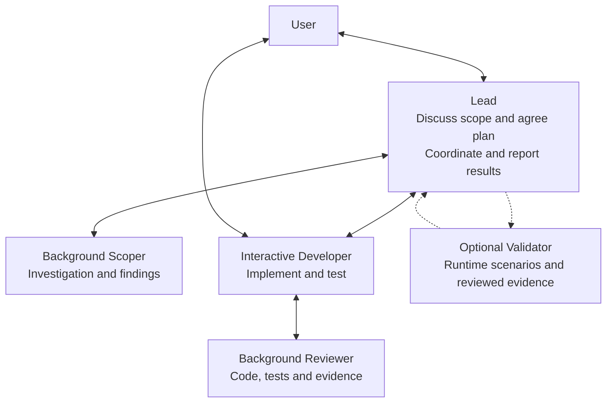
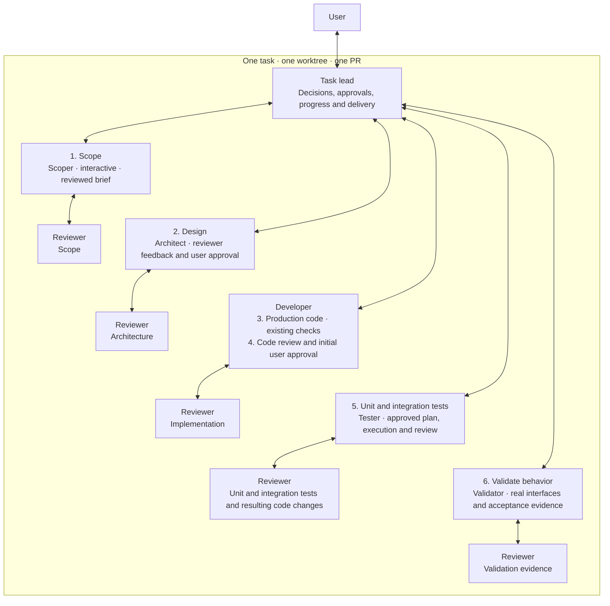
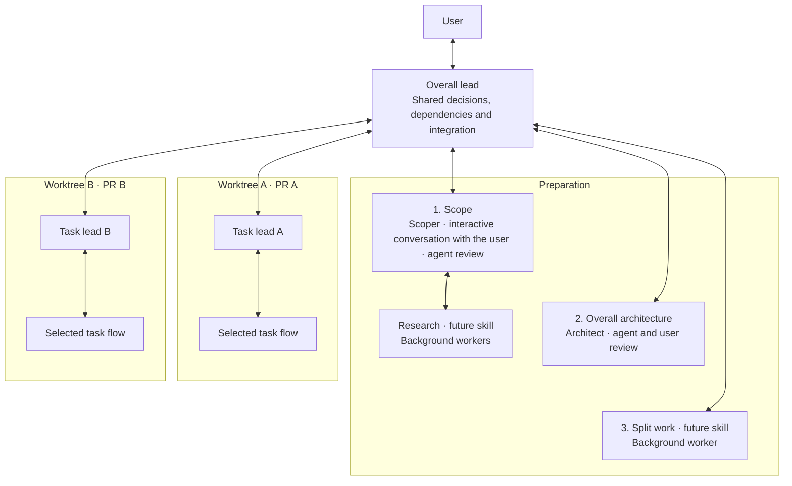

# Coordinated agent workflow

Status: Draft for discussion

## Objective and background

Reduce the attention spent coordinating coding agents while preserving direct control over outcomes,
architecture, code structure and testing quality. Information should move smoothly between contexts,
and decisions should arrive with enough explanation and evidence for the user to make a call
efficiently.

The current workflow relies on the user to start sessions, transfer context, reconcile discoveries,
review changes and manage PRs. As work grows, this makes the user both the technical decision maker
and the messenger between agents. The aim is selective delegation of that coordination. The user
continues to shape the work, enter individual conversations and review the artifacts that matter.

The first implementation will cover a single task. The user will continue to coordinate larger
efforts until the task workflow proves useful. Success means:

- Less manual transfer of context and fewer conversations to reconstruct.
- Clear decisions supported by evidence, with unresolved disagreements visible.
- Reliable follow-through on reviews, comments and changes to the plan.

## Overview

Every task starts with the lead, which chooses the smallest useful workflow based on scope,
uncertainty, risk and the need for user discussion. Clear small tasks can use background scoping
with findings and a concise plan discussed in Lead. Unclear tasks can start with the same bounded
investigation; the lead discusses findings and questions with the user and opens an interactive scoper if sustained
discussion is useful. Substantial tasks needing dedicated scoping can start interactively at once.
The lead revisits this choice as evidence develops, including during design, testing and validation.

A task corresponds to one PR and normally occupies one worktree. Its lead owns progress from
the initial request through scoping, design, implementation, testing, review and delivery. The
lead retains the purpose, current decisions, approval state, status and unresolved questions, while
delegating detailed work to other contexts.

Communication follows a tree. Workers communicate with their lead, and task leads
communicate with the overall lead when one exists. Findings affecting another task travel
through that common parent. The user can interact directly with any interactive worker; the worker
then reports consequential decisions back through the tree.

### Small task flow

Small tasks still involve scoping, planning, implementation and testing. A background Scoper can
investigate scope, Lead can discuss the findings and agree a concise plan, and an interactive
Developer can perform implementation and testing in the same conversation.
Lead can also handle straightforward scoping directly. Developer obtains independent review,
addresses findings and reports results to the lead. Relevant runtime validation can be included in
that assignment or delegated separately. Non-interactive development is reserved for rare, tiny,
well-defined changes such as a small configuration edit.

The diagram shows conversations and handoffs; one conversation can cover several distinct steps.
One agreed plan may authorize implementation, tests and relevant validation. Additional approval
is needed for material changes to scope or design or checkpoints explicitly chosen with the user.
Existing approvals carry forward across agent handoffs. A preliminary investigation returns
evidence, assumptions and open questions; it need not produce a complete reviewed brief. If an
interactive scoper is opened later, it receives those findings and decisions so work is not repeated.

### Medium task flow

A medium task can use a background Scoper initially, an interactive Architect to work through
the design and an interactive Developer for implementation. Testing can be assigned to a
non-interactive Tester once its direction is agreed, with background Validator work where runtime
evidence is needed. Reviews and documentation updates stay in the background. Open an interactive
Scoper, Tester or Validator when that step needs sustained discussion with the user.

### Large task flow

For a large task, dedicated Scoper, Architect, Developer, Tester and Validator conversations can
all be interactive. The following shows that expanded workflow, including optional code-before-tests
and test-plan approval checkpoints. Reviews and documentation updates stay in the background.
Stages can still be combined or omitted, and a new stage or agent does not itself require approval.

The numbered stages show the expanded progression; the arrows show delegation and reporting back.
Reviewer nodes are assignments of the same role, each reporting to its commissioning owner. The user
starts with the lead and can enter an interactive specialist conversation where useful. Background
workers send user questions through the lead. Workers can delegate bounded research or review.

**1. Scope.** A dedicated scoper can investigate in the background or work directly with the user
on the problem, outcome, constraints, acceptance criteria and open questions. When assigned a
complete brief, it obtains reviewer feedback and returns a reviewed direction and remaining
unknowns. A background investigation can instead return findings for the lead to use in planning
or pass into a later interactive discussion. The user does not relay research or review exchanges.

**2. Design the task.** Where a dedicated architect helps, it develops the approach, including
interfaces or a skeleton where useful, works through tradeoffs and obtains reviewer feedback.
It reports the plan, decisions, approval state and open questions to the lead. Interactive work
discusses decisions directly with the user; background work returns them through the lead.
Implementation proceeds within the agreed plan or approved design.

**3. Implement.** The lead normally starts an interactive Developer conversation. The
developer builds the agreed plan or design and runs existing checks. It includes unit and
integration tests unless the chosen workflow assigns them separately or includes a
code-before-tests checkpoint.

**4. Review the code.** The developer commissions an independent reviewer to assess the
implementation against the approved design and requirements, addresses findings and obtains
follow-up review of relevant changes. Combined assignments include the tests in this review.
If the user has chosen a code-before-tests checkpoint, the lead obtains and records that approval
before test authoring. Review findings alone do not create an additional user approval checkpoint.

**5. Write unit and integration tests.** When testing is assigned separately, the tester receives
the plan or design, implementation report and existing authorization. It selects concise tests
from requirements, acceptance examples and identified risks. It honors any chosen code or test-plan
approval checkpoints, writes and runs tests and applicable checks, obtains independent review,
addresses findings and reports results and gaps to the lead. Production-code failures return through
the lead to the developer. Material changes to approved decisions require renewed user agreement.

**6. Validate behavior.** When relevant to acceptance, the developer or a separate validator starts
the app or server and exercises scenarios through real interfaces. It returns evidence, failures
and untested paths for reviewer assessment, addresses evidence gaps and obtains follow-up review
where needed. The lead routes failures to the assigned implementation or testing owner and arranges
follow-up validation after fixes. A separate validator context is optional.

**Review and deliver.** The lead continues through PR creation, checks, PR review comments and
merge readiness. Creating, committing, pushing and merging remain subject to the user's
authorization. A completed worker assignment does not by itself mean the task is accepted or ready
to merge.

Findings can reopen scope, architecture or implementation. Keep the structure shallow: one lead
with stage owners beneath it, supported by bounded research and review assignments. Reassess which
stages need their own context, interactive discussion or an explicitly agreed checkpoint as the
work develops.

### Larger efforts across worktrees

This larger-effort flow is a future extension; the research and task-splitting skills are deferred.
Preparation establishes the direction before parallel implementation starts. Arrows show
communication through the coordinating parent; there are no direct links between sibling agents or
worktrees. Each task lead chooses the small, medium or large flow appropriate to its own task.

**1. Scope the overall effort.** The user starts with the overall lead, which chooses bounded
investigation or a dedicated interactive scoper according to uncertainty, risk and discussion needs.
This expanded example uses an interactive scoper to establish the problem, desired outcome,
constraints, acceptance criteria and open questions, supported by background research workers.
The scoper commissions review and investigates its findings before returning a reviewed brief and
suggested direction to the lead, which commissions overall architecture before the work is divided
across worktrees.

**2. Design the architecture.** A high-level architect develops the overall solution, boundaries,
shared contracts and major tradeoffs, with user and agent review. This architecture stays above
implementation detail.

**3. Split the work.** Once the deferred split-work skill is available, the lead can delegate it
to a background worker. It turns the approved architecture into tasks with clear outcomes,
dependencies and an integration sequence, then returns the breakdown to the lead.

**4. Coordinate the tasks.** An overall lead coordinates execution across worktrees,
communicating with each task lead. Each task uses the appropriate steps and interaction modes.
The overall lead owns shared decisions, dependency management and verification of the combined outcome.
The overall lead remains the coordinating context from the initial request through
preparation and execution.

**Revisit shared decisions.** When a task reveals a problem with the shared design, its lead
reports the discovery upward. The overall lead returns design questions to the architect and
commissions a revised task breakdown where needed. It obtains the necessary review and user
decision, and updates affected task leads. Affected work waits for the revised direction;
unrelated work can continue. Task workers do not negotiate changes directly with workers in other
worktrees.

## Detailed design

### Agents and skills

An agent role defines responsibility and the context in which work happens. A skill defines a
repeatable procedure that a suitable agent can perform. Stages, roles and conversations need not map
one to one, and a role does not automatically require a custom agent definition.

The workflow has seven configured Codex agent roles:

| Role | Responsibility and output | User interaction |
| --- | --- | --- |
| Scoper | Investigates requirements and returns findings or a reviewed brief, suggested direction and unresolved questions | Background investigation or direct scoping discussion |
| Lead | Chooses and adapts the workflow; scopes and plans or delegates, retains decisions and approvals, tracks progress and routes findings | Starting point and continuing coordination |
| Architect | Develops a design and implementation plan; works through tradeoffs and obtains reviewer feedback | Direct discussion or decisions returned through Lead |
| Developer | Implements the agreed plan, includes tests and validation as assigned, addresses review findings and reports design drift | Normally interactive; background only for tiny, well-defined assignments |
| Tester | Plans, authors and runs separately assigned unit and integration tests within existing authorization and chosen checkpoints | Through Lead or directly when test discussion is useful |
| Reviewer | Independently reviews scope, architecture, implementation, unit and integration tests and validation evidence; reports findings to the commissioning owner | Normally background; available at relevant stages |
| Validator | Runs the app or server and exercises acceptance scenarios through real interfaces; returns evidence, failures and untested paths | Available for discussion of behavior and evidence |

The lead remains responsible throughout. Delegation protects its context: workers retain exploration
and implementation detail, while the lead receives conclusions, supporting evidence, deviations and
unresolved questions. The developer can own implementation, unit and integration tests and relevant
validation under one agreed plan. Separate tester and validator contexts are available when useful.
Each reviewer reports to the owner that commissioned the review.

Lead can scope and plan directly. A background scoper keeps investigation out of the user
conversation and returns evidence, assumptions and questions to Lead. If sustained discussion
becomes useful, Lead opens an interactive scoper with those findings and decisions. A complete
reviewed brief can support planning in Lead or a dedicated architect's detailed design.

Review of a complete scoping brief uses the existing reviewer role. The scoper gives the reviewer its rough brief and
supporting evidence; the reviewer challenges assumptions, missing requirements and the proposed
direction. They can iterate and commission further research without the user managing each exchange.
The scoper owns synthesis and reports unresolved disagreements alongside the brief. Questions
requiring the user's intent or preferences return through Lead for background work or directly in
interactive work. This preserves the tree:
lead → scoper → reviewer, with no additional scoping role.

Research is a planned reusable skill, with its definition deferred for now. Scopers, leads and
architects can commission bounded research for scoping or design, normally in a background worker
that the user does not interact with directly. That execution context does not introduce another
agent role. Each worker reports findings, evidence and uncertainties to the context that assigned
the question; that context owns the resulting scope or design decisions.

The same lead and architect roles can operate at overall and individual-task levels in separate
contexts. The overall lead owns shared decisions, dependencies and verification of the combined
result; each task lead owns its task lifecycle. The overall architect produces the shared design
and reports to the overall lead. Each task architect works from its task brief and relevant shared
design, produces the detailed implementation plan, and reports to its task lead. A plan is an
output of architectural work, not a separate agent role.

Task splitting is another planned skill, deferred for now. Given an approved architecture, it will
produce bounded tasks, dependencies and an integration sequence. The lead can later delegate this
procedure to a background worker and use the returned breakdown to assign work to task leads. It
does not require a dedicated planner role.

Other skills can capture procedures shared across roles. Candidate procedures cover:

- **Delegation and handoff:** prepare an assignment and return findings, decisions and open
  questions.
- **Review and feedback:** assess an artifact, reconcile comments and verify the resulting changes.
- **Stage completion:** check the outcome, documentation and harness obligations before handing
  back.
- **Local-stack validation:** start a disposable local stack, exercise real API and MCP requests,
  collect evidence and clean up the resources created for the run.

The remaining skill set stays open. Role instructions should remain small and refer to project
guidance rather than duplicate it.

Context breadth and lifetime are separate choices. A lead may remain responsible for a long time
while retaining only a compact picture of the work. A background worker may inspect extensive
material during a short research assignment. Leads decide whether to resume an existing context or start a
successor; the detailed policy, including how to revisit an architect, will be refined through use.
Required continuity should survive either choice.

### Local-stack validation skill

This is a reusable procedure for relevant runtime validation. Lead can include it in the developer's
approved assignment or use a separate validator when useful. It complements unit and integration
tests by checking the assembled application through its real interfaces.

The assignment supplies the code revision or working-tree state, acceptance scenarios, required
services and fixtures, and expected outcomes. The skill follows the repository's setup instructions
and existing authentication configuration. Its basic sequence is:

1. **Prepare an isolated stack.** Allocate separate ports, disposable databases or volumes and test
   data for this run. Apply the current migrations and start the application and required services.
   Record which resources belong to the run and wait for readiness before exercising behavior.
1. **Exercise real requests.** Call the running API over HTTP and use an MCP client/session for
   initialization, tool discovery and tool calls relevant to the task. Check response contents,
   expected errors and resulting state changes against the acceptance scenarios. A successful
   startup or health check alone does not establish that the feature works.
1. **Report and clean up.** Return the scenarios exercised, expected and actual outcomes, useful
   request/response evidence and logs, and any failures or untested paths. Record which external
   dependencies were exercised or substituted. Keep secrets out of reports. Stop the processes and
   remove only the disposable resources created for this run, including after failure; report any
   resources left running.

The lead routes failures to the relevant owner and arranges another run after fixes. For a
complex task, the overall lead can commission the same skill against the combined result
after integration. The reviewer assesses validation evidence. Production fixes return to the
developer, and unit or integration regression tests go to the assigned implementation or testing
owner within the agreed authorization and checkpoints. Scoping-only investigations do not require
starting a stack.

### Realizing the workflow in Herdr TUI

The current Codex setup provides all seven roles as CLI profiles and custom subagent definitions
with the same instructions. For example, profile `agentic-scoper` and custom subagent `scoper`
both use the Scoper role. Assignments explicitly state the interaction mode and user-question
channel; the role name alone does not tell an agent whether the user will participate directly.
Developer is normally interactive. Independent reviews use custom `reviewer` subagents. The cross-provider
review convention discussed below is a future option from the original research; it is not required
by the current role instructions.

The first trial will use **Herdr TUI with herdr-reviewr**. Herdr supplies interactive agent panes
and commands for launching, contacting and observing agents. Role instructions and skills define the
delegation tree, approval boundaries and stage transitions. The reviewr plugin supplies the user's
diff review interface; it is separate from the background reviewer agent described above. The design
below uses documented capabilities checked on 2026-11-11; the complete workflow still needs a
practical trial.

#### Choosing Claude Code or Codex

The agent launching a worker chooses the coding application through
`herdr agent start --kind claude` or `--kind codex`. Options after `--` are passed to that
application's CLI, including model selection. Herdr executes the choice; role instructions can
prescribe it or delegate the choice to the caller. This applies to the scoper launching its own
reviewer as well as the lead launching stage owners.
[Herdr launch documentation](https://github.com/herdrdev/herdr/blob/master/docs/versions/0.9.5/website/src/content/docs/agent-automation.mdx#agent-identity-and-launch).

The future cross-provider review convention would use the other coding application: Claude Code work is reviewed
by Codex, and Codex work by Claude Code. For this pairing, launch the reviewer through Herdr and
give it the scoper's return address. It remains a background assignment from the user's perspective,
even though it runs in an inspectable pane. Built-in subagents remain useful for other bounded work;
launching a different coding application is handled through Herdr. Specific models and any role
defaults remain to be chosen.

#### Delegation and reporting

For an interactive assignment, the lead creates a tab or pane, starts a named worker with
`herdr agent start`, and gives it
an assignment through `herdr agent prompt`. The assignment includes the lead's return
address. The worker can use the same prompt command to report back, including after a direct
conversation with the user. This requires no manual copying between chats. Herdr TUI provides the
delivery mechanism; the workflow establishes the parent relationship and reporting obligations.
[Herdr agent automation](https://github.com/herdrdev/herdr/blob/master/docs/versions/0.9.5/website/src/content/docs/agent-automation.mdx).

The delegation-and-handoff skill should make every assignment self-contained: task identity, working
directory, role, interaction mode, user-question channel, approved inputs, expected outcome,
approval boundaries, parent address and reporting triggers. For example, an architect's brief
would include:

> Your role is Architect; interaction mode is interactive. Discuss design questions directly with
> the user here. Your lead and return address is `task42-lead`. Obtain independent reviewer feedback.
> After addressing findings and obtaining user approval, save the plan and report its location,
> approved decisions and open issues using `herdr agent prompt task42-lead "
"` without
> `--wait`. Report blockers and discoveries affecting scope as they arise. Do not begin implementation.

Reports should distinguish progress, a request for a decision and completion of an assignment. The
lead acknowledges the report and checks the relevant approval before assigning the next
stage. A worker's ordinary final answer is not automatically forwarded. `agent wait` observes
lifecycle state, not task acceptance; the workflow must not interpret an idle agent as an approved
result. Return messages should not use `--wait`, so a worker does not wait on a lead that is
already waiting for it. Live names are session addresses, so replacing an agent requires updating
its assignment links. These conventions belong in the shared handoff procedure.

#### Simple tasks: one worktree

1. **Scope.** Give the request to a named lead in the task's worktree.
   It can use a non-interactive Scoper for small tasks and discuss the findings with the user.
   For unclear work, it starts with bounded background investigation and decides whether to continue
   here or open an interactive scoper. Clear substantial work can start interactively immediately.
1. **Plan.** Lead discusses the scoped direction with the user and agrees the implementation,
   testing, relevant validation and any chosen checkpoints.
1. **Implement.** Lead opens an interactive Developer with the plan, working directory,
   acceptance criteria and authorization. The user can discuss the implementation directly there.
   Developer implements and runs applicable existing checks within the assignment.
1. **Test.** In the same Developer conversation, author and run the assigned tests, honoring any
   chosen checkpoints. Obtain background review of code and tests, address findings and return
   results and gaps to Lead, which tracks any remaining work.

Expand when useful. Open an interactive specialist with the corresponding profile, the same
worktree, findings, decisions and Lead's return address when ongoing user discussion is needed.
A separate Architect, Tester or Validator can also work in the background when appropriate.
Reassess this choice when later stages uncover uncertainty or risk. Relevant runtime validation can stay with Developer
or be assigned separately, with evidence review and cleanup either way. Sharing a worktree does
not authorize simultaneous conflicting edits.

The user can review through reviewr and send comments to the responsible context. That context
reports consequential changes to Lead, which tracks checks, feedback and delivery readiness.
PR creation, commits, pushes and merges retain their existing authorization boundaries.

The lead maintains a compact task record with the brief, current stage, worker addresses,
artifact locations, approval state and unresolved decisions when handoffs need one. A small task
can use the concise plan already agreed in the conversation. Written artifacts use the project's
established location and dated filenames; the record links to them rather than collecting transcripts.

Trial the small flow with background scoping and interactive development. Separately, try background
scoping that reveals a need for interactive discussion and verify that findings, decisions and questions carry into the new
conversation without repetition. Try a medium flow with background testing or validation, then a
large flow with interactive specialists, including a design change made directly with an architect
and incorporated into the next assignment.

#### Complex tasks: leads across worktrees

The user starts with the overall lead, which chooses the scoping mode. When dedicated scoping is
useful, it receives the scoper's reviewed brief. In this future extension, it commissions the
overall architect and, once the
deferred split-work skill is available, delegates it after design approval using the same assignment
and reporting procedure. After the task breakdown is approved, it arranges one worktree and task
lead per PR. Each task lead receives its
own working directory, relevant design, dependencies, integration order and the overall
lead's return address. Within that worktree, it runs the simple flow above.

Keep these agents on the same Herdr server for the initial implementation: live agent names can be
addressed across its workspaces. Use task-specific names, such as `task42-lead`, so several
tasks can run together. The reporting tree remains a workflow convention: workers contact their task
lead, and task leads contact the overall lead. Shared-design changes travel
upward for reconciliation and approval, then downward as revised assignments; affected leads
acknowledge the revision before continuing.

Cross-worktree messaging does not share files automatically. In particular, each worktree has its
own gitignored `.context` directory. The overall lead should maintain the shared design and
task register in one known location and pass explicit artifact paths on the same machine. Task
reports identify the design revision they used. This lets the lead reconcile dependencies,
shared documentation and integration results without importing workers' full conversations.

#### Local review and incoming PR feedback

The user can use reviewr to inspect uncommitted, branch, last-turn or commit diffs and send local
comments to a selected agent. Its PR tab also displays incoming reviews and comments; GitHub inline
threads include replies and resolved/outdated status. That view is read-only: reviewr does not reply
to or resolve PR threads, and it has no documented action for forwarding imported PR reviews to an
agent. Unsent local comments are lost when the pane closes.
[reviewr documentation](https://github.com/persiyanov/herdr-reviewr),
[PR feedback implementation](https://github.com/persiyanov/herdr-reviewr/blob/main/src/forge.rs).

Incoming PR feedback therefore needs a separate lead procedure using the hosting service's
tools. It fetches review bodies and inline threads, routes findings to the appropriate worker,
records their disposition and verifies fixes. Replies and thread resolution remain subject to
authorization. Viewing feedback in reviewr does not itself assign or complete that work.

#### Desktop comparison

Herdr desktop/core is a separate runtime with native parent-child relationships and notifications;
its agents are not shared with the TUI. Its **herdr-reviewer** mod supports local diff comments,
agent submission and persistent drafts, but currently documents no incoming PR review view or
thread-management integration. TUI plus reviewr therefore covers more of the desired review workflow
for this trial, while desktop/core offers stronger built-in parent tracking.
[Herdr FAQ](https://herdr.dev/#questions),
[core delegation](https://github.com/herdrdev/herdr-core#agents-run-agents),
[desktop Reviewer](https://github.com/vytasgavelis/herdr-reviewer).

## Other key notes

### Human attention and feedback

Requests for judgment should explain the decision, relevant alternatives, recommendation and
unresolved disagreement. User comments go to the context doing the work. That context owns reporting
changes affecting scope, approvals or subsequent work. PR review comments may arrive after the
internal reviewer has finished; the task lead routes them, tracks resolution and arranges any
renewed review. Feedback belongs in actual review comments or conversations, never as review markers
embedded in source code.

### Documentation and harness upkeep

Each stage owner assesses whether its work changes maintained documentation or exposes a recurring
weakness in instructions, checks or handoffs. It addresses changes within scope and raises broader
proposals. Reviewers check this obligation, and the task lead ensures it is complete before
delivery. The overall lead reconciles changes shared across tasks. Final reconciliation
complements upkeep throughout the work.

### Continuity and approval

Handoffs preserve current requirements, decisions and rationale, authorization, chosen checkpoints,
relevant artifacts and open questions. Proposals remain distinguishable from approved decisions.
One agreed plan may authorize implementation, tests and relevant validation. Preserve approval that
still covers the work; an additional stage or agent does not itself require a new approval.
Material scope or design changes need renewed user agreement before dependent work continues, and
explicit checkpoints remain binding. Review relevant changes independently. A successor context
should continue from this state without reconstructing every conversation.

### Initial scope and subsequent design

Try the small, medium and large examples with the configured Codex roles and native review.
Include background investigation that leads to interactive scoping and substantial work that starts
interactively. Verify that Developer normally opens interactively, decisions and approvals survive
handoffs, and the selected steps produce useful acceptance evidence.
Cross-provider review remains a future option. The seven Codex roles are configured; model choices,
cross-provider configuration and skill packaging remain to be decided. Research and
task-splitting skill definitions are deferred. Cross-worktree orchestration will follow once the
small task workflow is useful in practice.
