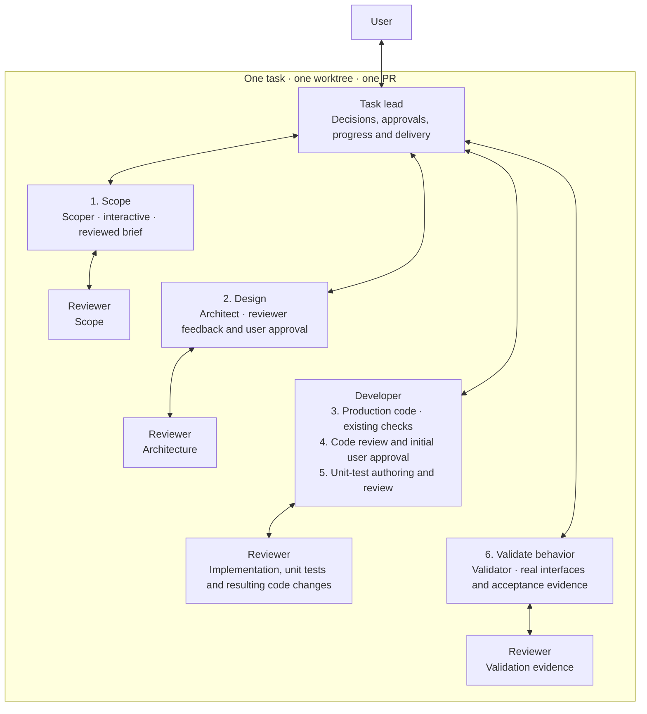
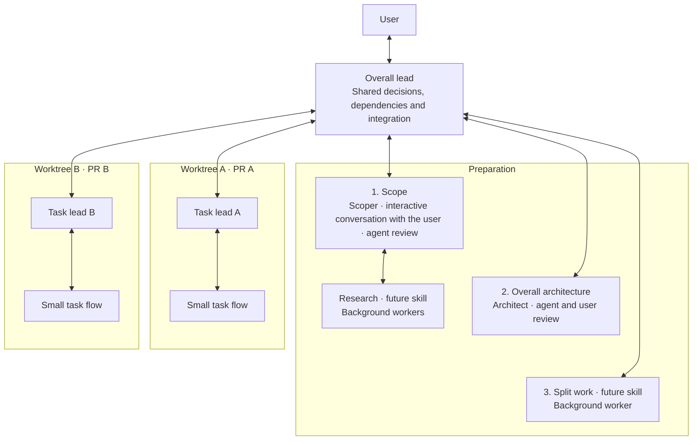

# Coordinated agent workflow

Status: Draft for discussion

## Objective and background

Reduce the attention spent coordinating coding agents while preserving direct control over outcomes,
architecture, code structure and testing quality. Information should move smoothly between contexts,
and decisions should arrive with enough explanation and evidence for the user to make a call
efficiently.

The current workflow relies on the user to start sessions, transfer context, reconcile discoveries,
review changes and manage PRs. As work grows, this makes the user both the technical decision maker
and the messenger between agents. The aim is selective delegation of that coordination. The user
continues to shape the work, enter individual conversations and review the artifacts that matter.

The first implementation will cover a single task. The user will continue to coordinate larger
efforts until the task workflow proves useful. Success means:

- Less manual transfer of context and fewer conversations to reconstruct.
- Clear decisions supported by evidence, with unresolved disagreements visible.
- Reliable follow-through on reviews, comments and changes to the plan.

## Overview

Every task starts with the lead, which launches a separate interactive scoper. For a larger
effort, the overall lead takes that coordinating role. The user and the scoper establish the
problem, desired outcome, constraints, acceptance criteria and open questions, supported by
background research workers. The scoper returns a reviewed brief and suggested direction to the
lead, which uses it to commission architecture.

A task corresponds to one PR and normally occupies one worktree. Its lead owns progress from
the initial request through scoping, design, implementation, testing, review and delivery. The
lead retains the purpose, current decisions, approval state, status and unresolved questions, while
delegating detailed work to other contexts.

Communication follows a tree. Workers communicate with their lead, and task leads
communicate with the overall lead when one exists. Findings affecting another task travel
through that common parent. The user can interact directly with any interactive worker; the worker
then reports consequential decisions back through the tree.

### Small task flow

The numbered stages show the usual progression; the arrows show delegation and reporting back.
Reviewer nodes are assignments of the same role, each reporting to its commissioning owner. The user
starts with the lead, which launches the scoper, and can enter any interactive worker's conversation.
The scoper has its own context, including for small tasks. Workers may use background workers for
bounded research or review.

**1. Scope.** The lead receives the initial request and launches a separate interactive scoper.
The user and scoper clarify the problem, desired outcome, constraints, acceptance criteria and open
questions. The scoper can delegate bounded research questions and asks a reviewer to challenge the
emerging brief. It works through findings before returning a reviewed brief, suggested direction and
remaining unknowns or disagreements to the lead. Detailed solution design belongs to the architect.
The user does not need to manage research or review exchanges or relay the scoper's findings.

**2. Design the task.** Once the scope is sufficiently clear, the lead starts an interactive
architect. The architect develops the detailed approach, including interfaces or a skeleton where
useful, works through tradeoffs with the user and obtains reviewer feedback. After addressing
findings and obtaining user approval, it returns the plan, decisions and remaining questions to the
lead. Implementation proceeds from that approved design.

**3. Implement.** The lead assigns implementation to a developer in a separate context. The
developer builds the approved design, focusing on production code. It can run existing tests and
applicable checks during implementation, but does not write new unit tests yet.

**4. Review the code.** The developer commissions an independent reviewer to assess the
implementation against the approved design and requirements, and addresses the findings. The user
then gives initial approval of the implementation. The lead records that approval before assigning
unit-test authoring. This gate keeps the developer's context focused on production code and avoids
spending effort writing tests for an implementation that has not yet been accepted as the basis for
further work. Initial code approval permits unit-test work; it does not mean the task is finished.

**5. Write unit tests.** The developer writes and runs unit tests from the requirements and
acceptance examples. A reviewer assesses the tests and any resulting production-code changes. The
developer addresses findings; changes affecting approved decisions return for renewed review and
user approval as needed.

**6. Validate behavior.** The lead assigns a validator to start the app or server and exercise
acceptance scenarios through its real interfaces. The validator can use the local-stack validation
skill and returns evidence, failures and untested paths, with reviewer assessment of the evidence.
The lead routes failures to the relevant owner and arranges follow-up validation after fixes.
Unit-test authoring remains the developer's responsibility.

**Review and deliver.** The lead continues through PR creation, checks, PR review comments and
merge readiness. Creating, committing, pushing and merging remain subject to the user's
authorization. A completed worker assignment does not by itself mean the task is accepted or ready
to merge.

These are responsibilities and approval boundaries, rather than a rigid one-way pipeline. Findings
can reopen scope, architecture or implementation. The structure stays shallow: one lead with one
layer of interactive workers beneath it, supported by bounded research and review assignments.
Stages run as needed; the tree describes responsibility and communication, not simultaneous
execution of every role.

### Big task flow

This larger-effort flow is a future extension; the research and task-splitting skills are deferred.
Preparation establishes the direction before parallel implementation starts. Arrows show
communication through the coordinating parent; there are no direct links between sibling agents or
worktrees. Each small task flow expands into the structure above.

**1. Scope the overall effort.** The user starts with the overall lead, which launches a
dedicated interactive scoper. The user and scoper establish the problem, desired outcome,
constraints, acceptance criteria and open questions, supported by background research workers.
The scoper commissions review and investigates its findings before returning a reviewed brief and
suggested direction to the lead, which commissions overall architecture before the work is divided
across worktrees.

**2. Design the architecture.** A high-level architect develops the overall solution, boundaries,
shared contracts and major tradeoffs, with user and agent review. This architecture stays above
implementation detail.

**3. Split the work.** Once the deferred split-work skill is available, the lead can delegate it
to a background worker. It turns the approved architecture into tasks with clear outcomes,
dependencies and an integration sequence, then returns the breakdown to the lead.

**4. Coordinate the tasks.** An overall lead coordinates execution across worktrees,
communicating with each task lead. Each task follows the small task flow. The overall
lead owns shared decisions, dependency management and verification of the combined outcome.
The overall lead remains the coordinating context from the initial request through
preparation and execution.

**Revisit shared decisions.** When a task reveals a problem with the shared design, its lead
reports the discovery upward. The overall lead returns design questions to the architect and
commissions a revised task breakdown where needed. It obtains the necessary review and user
decision, and updates affected task leads. Affected work waits for the revised direction;
unrelated work can continue. Task workers do not negotiate changes directly with workers in other
worktrees.

## Detailed design

### Agents and skills

An agent role defines responsibility and the context in which work happens. A skill defines a
repeatable procedure that a suitable agent can perform. Stages, roles and conversations need not map
one to one, and a role does not automatically require a custom agent definition.

The workflow has six agent roles:

| Role | Responsibility and output | User interaction |
| --- | --- | --- |
| Scoper | Clarifies the problem, outcome, constraints and acceptance criteria; returns a reviewed brief, suggested direction and unresolved questions | Separate interactive conversation after delegation |
| Lead | Owns the task throughout its lifecycle; delegates, retains decisions and approval state, tracks progress and routes findings | Starting point and continuing coordination |
| Architect | Develops the detailed design and implementation plan; works through tradeoffs and obtains reviewer feedback before user approval | Direct discussion and plan approval |
| Developer | Implements the approved design; after initial code review and user approval, writes and runs unit tests; addresses review and validation findings | Initial code approval and discussion of changes |
| Reviewer | Independently reviews scope, architecture, implementation, unit tests and validation evidence; reports findings to the commissioning owner | Normally background; available at relevant stages |
| Validator | Runs the app or server and exercises acceptance scenarios through real interfaces; returns evidence, failures and untested paths | Available for discussion of behavior and evidence |

The lead remains responsible throughout. Delegation protects its context: workers retain exploration
and implementation detail, while the lead receives conclusions, supporting evidence, deviations and
unresolved questions. Production-code implementation and unit-test authoring belong to the developer,
with an explicit approval boundary between them. Runtime validation uses a separate validator
context. Each reviewer reports to the owner that commissioned the review.

The scoper owns the interactive requirements discussion and returns a reviewed brief and suggested
direction. It runs in a separate context from the lead, keeping exploration out of the lead's
conversation. Background workers can answer bounded research questions in support of scoping; the
lead uses the scoper's report to commission the architect's detailed design.

Scoping review uses the existing reviewer role. The scoper gives the reviewer its rough brief and
supporting evidence; the reviewer challenges assumptions, missing requirements and the proposed
direction. They can iterate and commission further research without the user managing each exchange.
The scoper owns synthesis and reports unresolved disagreements alongside the brief. Questions
requiring the user's intent or preferences still return to the user. This preserves the tree:
lead → scoper → reviewer, with no additional scoping role.

Research is a planned reusable skill, with its definition deferred for now. Scopers, leads and
architects can commission bounded research for scoping or design, normally in a background worker
that the user does not interact with directly. That execution context does not introduce a seventh
agent role. Each worker reports findings, evidence and uncertainties to the context that assigned
the question; that context owns the resulting scope or design decisions.

The same lead and architect roles can operate at overall and individual-task levels in separate
contexts. The overall lead owns shared decisions, dependencies and verification of the combined
result; each task lead owns its task lifecycle. The overall architect produces the shared design
and reports to the overall lead. Each task architect works from its task brief and relevant shared
design, produces the detailed implementation plan, and reports to its task lead. A plan is an
output of architectural work, not a separate agent role.

Task splitting is another planned skill, deferred for now. Given an approved architecture, it will
produce bounded tasks, dependencies and an integration sequence. The lead can later delegate this
procedure to a background worker and use the returned breakdown to assign work to task leads. It
does not require a dedicated planner role.

Other skills can capture procedures shared across roles. Candidate procedures cover:

- **Delegation and handoff:** prepare an assignment and return findings, decisions and open
  questions.
- **Review and feedback:** assess an artifact, reconcile comments and verify the resulting changes.
- **Stage completion:** check the outcome, documentation and harness obligations before handing
  back.
- **Local-stack validation:** start a disposable local stack, exercise real API and MCP requests,
  collect evidence and clean up the resources created for the run.

The remaining skill set stays open. Role instructions should remain small and refer to project
guidance rather than duplicate it.

Context breadth and lifetime are separate choices. A lead may remain responsible for a long time
while retaining only a compact picture of the work. A background worker may inspect extensive
material during a short research assignment. Leads decide whether to resume an existing context or start a
successor; the detailed policy, including how to revisit an architect, will be refined through use.
Required continuity should survive either choice.

### Local-stack validation skill

This is a reusable procedure normally performed by the validator. The lead assigns runtime
validation to a separate validator context; a developer can also use the skill for diagnosis within
approved work. It complements unit tests by checking the assembled application through its real
interfaces.

The assignment supplies the code revision or working-tree state, acceptance scenarios, required
services and fixtures, and expected outcomes. The skill follows the repository's setup instructions
and existing authentication configuration. Its basic sequence is:

1. **Prepare an isolated stack.** Allocate separate ports, disposable databases or volumes and test
   data for this run. Apply the current migrations and start the application and required services.
   Record which resources belong to the run and wait for readiness before exercising behavior.
1. **Exercise real requests.** Call the running API over HTTP and use an MCP client/session for
   initialization, tool discovery and tool calls relevant to the task. Check response contents,
   expected errors and resulting state changes against the acceptance scenarios. A successful
   startup or health check alone does not establish that the feature works.
1. **Report and clean up.** Return the scenarios exercised, expected and actual outcomes, useful
   request/response evidence and logs, and any failures or untested paths. Record which external
   dependencies were exercised or substituted. Keep secrets out of reports. Stop the processes and
   remove only the disposable resources created for this run, including after failure; report any
   resources left running.

The lead routes failures to the relevant owner and arranges another run after fixes. For a
complex task, the overall lead can commission the same skill against the combined result
after integration. The reviewer assesses validation evidence, and any needed unit regression tests
return to the developer under the unit-test authoring approval boundary. The first scoping-only
experiment does not require starting a stack.

### Realizing the workflow in Herdr TUI

The first trial will use **Herdr TUI with herdr-reviewr**. Herdr supplies interactive agent panes
and commands for launching, contacting and observing agents. Role instructions and skills define the
delegation tree, approval boundaries and stage transitions. The reviewr plugin supplies the user's
diff review interface; it is separate from the background reviewer agent described above. The design
below uses documented capabilities checked on 2026-11-11; the complete workflow still needs a
practical trial.

#### Choosing Claude Code or Codex

The agent launching a worker chooses the coding application through
`herdr agent start --kind claude` or `--kind codex`. Options after `--` are passed to that
application's CLI, including model selection. Herdr executes the choice; role instructions can
prescribe it or delegate the choice to the caller. This applies to the scoper launching its own
reviewer as well as the lead launching stage owners.
[Herdr launch documentation](https://github.com/herdrdev/herdr/blob/master/docs/versions/0.9.5/website/src/content/docs/agent-automation.mdx#agent-identity-and-launch).

The proposed review convention is to use the other coding application: Claude Code work is reviewed
by Codex, and Codex work by Claude Code. For this pairing, launch the reviewer through Herdr and
give it the scoper's return address. It remains a background assignment from the user's perspective,
even though it runs in an inspectable pane. Built-in subagents remain useful for other bounded work;
launching a different coding application is handled through Herdr. Specific models and any role
defaults remain to be chosen.

#### Delegation and reporting

The lead creates a tab or pane, starts a named worker with `herdr agent start`, and gives it
an assignment through `herdr agent prompt`. The assignment includes the lead's return
address. The worker can use the same prompt command to report back, including after a direct
conversation with the user. This requires no manual copying between chats. Herdr TUI provides the
delivery mechanism; the workflow establishes the parent relationship and reporting obligations.
[Herdr agent automation](https://github.com/herdrdev/herdr/blob/master/docs/versions/0.9.5/website/src/content/docs/agent-automation.mdx).

The delegation-and-handoff skill should make every assignment self-contained: task identity, working
directory, approved inputs, expected outcome, approval boundaries, parent address and reporting
triggers. For example, an architect's brief would include:

> Your lead is `task42-lead`. Discuss the design with the user and obtain independent reviewer
> feedback. After addressing findings and obtaining user approval, save the plan and message the
> lead with its location, the approved decisions and any open issues. Report blockers and
> discoveries affecting scope as they arise. Do not begin implementation.

Reports should distinguish progress, a request for a decision and completion of an assignment. The
lead acknowledges the report and checks the relevant approval before assigning the next
stage. A worker's ordinary final answer is not automatically forwarded. `agent wait` observes
lifecycle state, not task acceptance; the workflow must not interpret an idle agent as an approved
result. Return messages should not use `--wait`, so a worker does not wait on a lead that is
already waiting for it. Live names are session addresses, so replacing an agent requires updating
its assignment links. These conventions belong in the shared handoff procedure.

#### Simple tasks: one worktree

1. **Start with the lead; delegate scoping.** Give the initial request to a named lead
   in the task's worktree. It launches a separate interactive scoper with the request and its return
   address. The user discusses the task with the scoper, which may delegate research to background
   workers and launches a reviewer using the other coding application. After working through review
   findings, the scoper saves and reports a rough idea of what to do, a suggested direction and open
   questions or disagreements. The lead receives that brief and uses it to commission
   architecture when the workflow proceeds beyond scoping.
1. **Open the architect conversation.** The lead launches an architect in another tab or
   pane, explicitly using the same worktree, and supplies the brief and return address. The user
   talks directly with the architect. After agent review and user approval, the architect saves the
   plan and sends the result back. The lead uses that report to brief the developer.
1. **Implement and review the code.** The lead starts a developer in the same worktree with the
   approved design. The developer focuses on production code and may run existing tests and checks.
   It commissions an independent code review, addresses findings and obtains initial user approval.
   The lead records that approval before assigning unit-test authoring.
1. **Write and review unit tests.** The developer writes and runs unit tests. A reviewer assesses
   the tests and any resulting code changes; the developer addresses findings and reports changes
   affecting approved decisions to the lead.
1. **Validate behavior.** The lead starts a separate validator in the same worktree to exercise
   acceptance scenarios through the running app or server. Its assignment can use local-stack
   validation with real API and MCP requests. The validator obtains review of the evidence and
   reports failures and untested paths. The lead routes follow-up work to the relevant owner.
   Sharing a worktree gives access to current files; it does not authorize simultaneous conflicting
   edits.
1. **Review and deliver.** The user reviews through reviewr and sends local comments to the worker
   responsible for the artifact. That worker reports consequential changes to the lead. The
   lead tracks checks, outstanding feedback and delivery readiness, retaining the existing
   authorization boundaries for PR creation, commits, pushes and merges.

The lead maintains a compact task record with the brief, current stage, worker addresses,
artifact locations, approval state and unresolved decisions. Plans and reports live under
`.context/plans/` and `.context/docs/` using dated filenames; the record links to them rather than
collecting whole transcripts.

The first experiment can stop at **lead → scoper → reviewer using the other coding
application → scoper → lead**. It should include review findings that the scoper addresses
before returning the brief. Success means that the lead receives the reviewed direction and
remaining questions without the user relaying the exchange. A subsequent full-task trial adds
architecture, implementation, unit-test authoring, runtime validation and review feedback, including
a design change made directly with the architect and correctly incorporated into the next assignment.

#### Complex tasks: leads across worktrees

The user starts with the overall lead, which launches the dedicated scoper and receives its
reviewed brief. In this future extension, it commissions the overall architect and, once the
deferred split-work skill is available, delegates it after design approval using the same assignment
and reporting procedure. After the task breakdown is approved, it arranges one worktree and task
lead per PR. Each task lead receives its
own working directory, relevant design, dependencies, integration order and the overall
lead's return address. Within that worktree, it runs the simple flow above.

Keep these agents on the same Herdr server for the initial implementation: live agent names can be
addressed across its workspaces. Use task-specific names, such as `task42-lead`, so several
tasks can run together. The reporting tree remains a workflow convention: workers contact their task
lead, and task leads contact the overall lead. Shared-design changes travel
upward for reconciliation and approval, then downward as revised assignments; affected leads
acknowledge the revision before continuing.

Cross-worktree messaging does not share files automatically. In particular, each worktree has its
own gitignored `.context` directory. The overall lead should maintain the shared design and
task register in one known location and pass explicit artifact paths on the same machine. Task
reports identify the design revision they used. This lets the lead reconcile dependencies,
shared documentation and integration results without importing workers' full conversations.

#### Local review and incoming PR feedback

The user can use reviewr to inspect uncommitted, branch, last-turn or commit diffs and send local
comments to a selected agent. Its PR tab also displays incoming reviews and comments; GitHub inline
threads include replies and resolved/outdated status. That view is read-only: reviewr does not reply
to or resolve PR threads, and it has no documented action for forwarding imported PR reviews to an
agent. Unsent local comments are lost when the pane closes.
[reviewr documentation](https://github.com/persiyanov/herdr-reviewr),
[PR feedback implementation](https://github.com/persiyanov/herdr-reviewr/blob/main/src/forge.rs).

Incoming PR feedback therefore needs a separate lead procedure using the hosting service's
tools. It fetches review bodies and inline threads, routes findings to the appropriate worker,
records their disposition and verifies fixes. Replies and thread resolution remain subject to
authorization. Viewing feedback in reviewr does not itself assign or complete that work.

#### Desktop comparison

Herdr desktop/core is a separate runtime with native parent-child relationships and notifications;
its agents are not shared with the TUI. Its **herdr-reviewer** mod supports local diff comments,
agent submission and persistent drafts, but currently documents no incoming PR review view or
thread-management integration. TUI plus reviewr therefore covers more of the desired review workflow
for this trial, while desktop/core offers stronger built-in parent tracking.
[Herdr FAQ](https://herdr.dev/#questions),
[core delegation](https://github.com/herdrdev/herdr-core#agents-run-agents),
[desktop Reviewer](https://github.com/vytasgavelis/herdr-reviewer).

## Other key notes

### Human attention and feedback

Requests for judgment should explain the decision, relevant alternatives, recommendation and
unresolved disagreement. User comments go to the context doing the work. That context owns reporting
changes affecting scope, approvals or subsequent work. PR review comments may arrive after the
internal reviewer has finished; the task lead routes them, tracks resolution and arranges any
renewed review. Feedback belongs in actual review comments or conversations, never as review markers
embedded in source code.

### Documentation and harness upkeep

Each stage owner assesses whether its work changes maintained documentation or exposes a recurring
weakness in instructions, checks or handoffs. It addresses changes within scope and raises broader
proposals. Reviewers check this obligation, and the task lead ensures it is complete before
delivery. The overall lead reconciles changes shared across tasks. Final reconciliation
complements upkeep throughout the work.

### Continuity and approval

Handoffs preserve the current requirements, decisions and their rationale, approval state, relevant
artifacts and open questions. Proposals remain distinguishable from approved decisions. A revised
design or implementation may need renewed review; an earlier approval does not automatically cover
subsequent changes. A successor context should be able to continue from this current state without
reconstructing every conversation.

### Initial scope and subsequent design

Start with the scoping and review loop in Herdr TUI, using Claude Code and Codex for the scoper and
reviewer in either order. Then extend the trial through architecture, implementation, unit-test
authoring, runtime validation and feedback with reviewr, with the user acting as the overall lead.
Model choices, role configuration and skill packaging remain to be decided. Research and
task-splitting skill definitions are deferred. Cross-worktree orchestration will follow once the
small task workflow is useful in practice.
